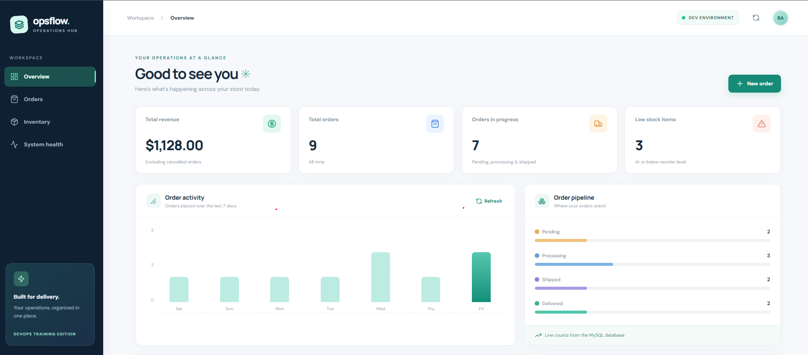
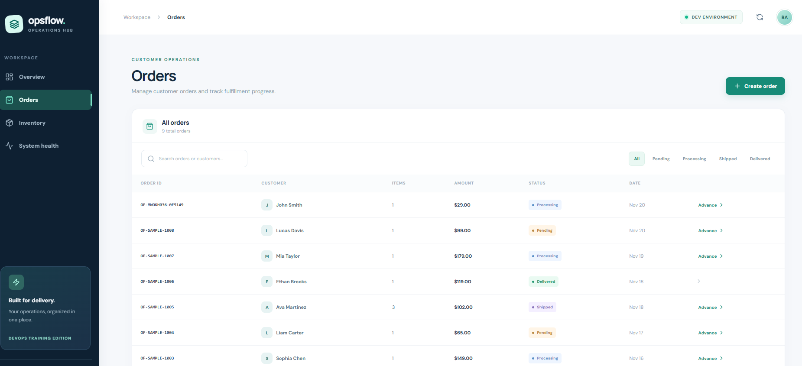
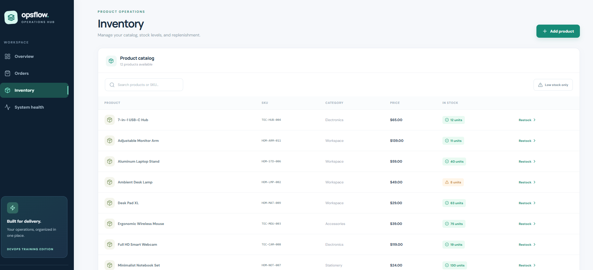

# OpsFlow

**Order & Inventory Management Platform**

*Manage products, track customer orders, and understand inventory performance from one clean, responsive workspace.*

OpsFlow is an open-source, full-stack web application built with **React**, **Node.js**, **Express**, and **MySQL**. It combines an interactive operations dashboard with product and order management, a REST API, and persistent relational data.

> **Project status:** Functional application starter. Authentication, access control, and production security hardening are not yet implemented. Use sample data and expose the application publicly by adding appropriate safeguards.

## Features

- **Operations dashboard:** Review revenue, order volume, active orders, low-stock products, recent orders, and seven-day order activity.
- **Product catalog:** Browse and search products, add new products, and track prices, stock quantities, and reorder thresholds.
- **Order management:** Create customer orders, review their items and history, search by customer or order code, and filter by status.
- **Inventory consistency:** Order creation uses MySQL transactions to deduct stock safely; cancelling an eligible order restores stock.
- **Order lifecycle:** Move orders through `pending → processing → shipped → delivered`, with cancellation supported from eligible states.
- **Health and observability:** Dedicated liveness and database-readiness endpoints, version information, and Prometheus-format metrics.
- **Responsive interface:** Desktop and mobile-friendly pages for day-to-day operations.

## Screenshots

Explore OpsFlow's modern and intuitive interface, designed to simplify order processing, inventory management, and business operations.

### Dashboard Overview

Get a complete overview of business performance, including total revenue, orders, inventory statistics, and recent activities.



### Order Management

Manage customer orders, track order statuses, and view detailed order information through an intuitive interface.



### Product & Inventory Management

Manage products, monitor stock availability, track inventory levels, and keep product information organized.



## Technology stack

| Layer | Technology |
| --- | --- |
| Frontend | React 18, Vite 6, JavaScript, custom CSS, Lucide icons |
| Backend | Node.js 24+, Express 4, REST/JSON |
| Database | MySQL 8.4, InnoDB |
| Database driver | `mysql2` |
| Monitoring endpoint | `prom-client` (Prometheus exposition format) |
| Automated backend tests | Node.js built-in test runner |

### Application architecture

```text
Browser
  │
  ▼
React frontend
  │  /api/*, /health/*, /metrics
  ▼
Express REST API
  │
  ▼
MySQL database
  ├── products
  ├── orders
  ├── order_items
  └── order_events
```

In local development, Vite proxies API and health requests to Express. In a deployed environment, configure a web server or reverse proxy to serve the frontend and forward the corresponding paths to the backend.

## Getting started

### Prerequisites

- Node.js **24 or newer** and npm
- MySQL **8.4** (or a compatible MySQL 8.x installation)
- A MySQL administrator account for initial database setup

### 1. Get the source

Clone the repository and open its root directory:

```bash
git clone https://github.com/YOUR_USERNAME/opsflow-order-management.git
cd opsflow-order-management
```

Replace `YOUR_USERNAME` with the GitHub account or organization that hosts the repository.

### 2. Initialize MySQL

From the repository root, create the schema and load sample records:

```bash
mysql -u root -p < database/01_schema.sql
mysql -u root -p < database/02_seed.sql
```

Create a dedicated application database account. For a backend connecting over TCP to `127.0.0.1`, an example is:

```sql
CREATE USER 'opsflow_app'@'127.0.0.1' IDENTIFIED BY 'REPLACE_WITH_A_STRONG_PASSWORD';
GRANT SELECT, INSERT, UPDATE, DELETE ON opsflow.* TO 'opsflow_app'@'127.0.0.1';
```

Adapt the permitted MySQL host to your actual deployment network. Keep credentials out of version control. The seed script is intended for a fresh database and should not be run repeatedly without resetting its data.

### 3. Configure and start the backend

```bash
cd backend
cp .env.example .env
npm install
npm test
npm run dev
```

Before running the application, edit `backend/.env` and set `DB_PASSWORD` to the password you created. The API listens on **http://localhost:8080** by default.

### 4. Start the frontend

In a separate terminal, from the repository root:

```bash
cd frontend
npm install
npm run dev
```

Open **http://localhost:5173** in your browser. Vite forwards `/api`, `/health`, and `/metrics` requests to the backend during development.

### 5. Verify the application

```bash
curl http://localhost:8080/health/live
curl http://localhost:8080/health/ready
curl http://localhost:8080/api/version
curl http://localhost:8080/api/dashboard
curl http://localhost:8080/metrics
```

The readiness check should report a connected database after MySQL has been initialized and the credentials are configured correctly.

## Environment configuration

Copy `backend/.env.example` to `backend/.env`. Supported variables include:

| Variable | Description | Default/example |
| --- | --- | --- |
| `NODE_ENV` | Node.js runtime mode | `development` |
| `PORT` | Backend HTTP port | `8080` |
| `DB_HOST` | MySQL host | `127.0.0.1` |
| `DB_PORT` | MySQL port | `3306` |
| `DB_USER` | MySQL application user | `opsflow_app` |
| `DB_PASSWORD` | MySQL application password | **Required: set locally** |
| `DB_NAME` | MySQL database | `opsflow` |
| `CORS_ORIGINS` | Comma-separated permitted browser origins | `http://localhost:5173` |
| `APP_ENV` | Environment label shown by the API and metrics | `DEV` |
| `APP_VERSION` | Release/version label | `1.0.0` |

Do not commit `.env` files, passwords, database dumps, or other secrets.

## API overview

The backend serves JSON endpoints under `/api` and exposes separate health and monitoring routes.

| Method | Endpoint | Description |
| --- | --- | --- |
| `GET` | `/api/dashboard` | Dashboard totals, recent orders, and activity |
| `GET` | `/api/products` | List/search products; supports `q`, `lowStock`, and `limit` |
| `POST` | `/api/products` | Create a product |
| `PATCH` | `/api/products/:id/restock` | Increase stock for a product |
| `GET` | `/api/orders` | List/search orders; supports `status`, `q`, and `limit` |
| `GET` | `/api/orders/:id` | Order details, items, and status history |
| `POST` | `/api/orders` | Create an order and deduct inventory transactionally |
| `PATCH` | `/api/orders/:id/status` | Update order status within allowed transitions |
| `GET` | `/api/version` | Application version and environment |
| `GET` | `/health/live` | API process liveness |
| `GET` | `/health/ready` | MySQL connectivity readiness |
| `GET` | `/metrics` | Prometheus-format metrics |

### Example: create a product

```bash
curl -X POST http://localhost:8080/api/products \
  -H 'Content-Type: application/json' \
  -d '{"sku":"ACC-100","name":"USB-C Adapter","category":"Accessories","price":29.99,"stock":25,"reorderLevel":5}'
```

### Example: create an order

Use product IDs returned by `GET /api/products`:

```bash
curl -X POST http://localhost:8080/api/orders \
  -H 'Content-Type: application/json' \
  -d '{"customerName":"Alex Rivera","customerEmail":"alex@example.test","items":[{"productId":1,"quantity":2}]}'
```

For the full API contract, payload examples, and response behavior, see [`docs/API.md`](docs/API.md).

## Testing and building

Run the backend unit tests:

```bash
cd backend
npm test
```

Build the frontend assets:

```bash
cd frontend
npm run build
```

Vite writes the production frontend build to `frontend/dist/`. A production deployment must configure static asset serving and API routing separately.

## Monitoring and health checks

- `GET /health/live` confirms the HTTP process is responding.
- `GET /health/ready` verifies that MySQL can be reached; returns HTTP `503` when it cannot.
- `GET /metrics` exposes Prometheus-compatible request, duration, process, and order activity metrics.
- `GET /api/version` identifies the running application release and environment.

The application exposes metrics, but it does **not** include a Prometheus server, Grafana instance, or infrastructure monitoring configuration.

## Repository structure

```text
opsflow-order-management/
├── frontend/           # React application
├── backend/            # Express API and unit tests
├── database/           # MySQL schema and sample data
├── docs/               # Additional documentation
├── .gitignore
├── LICENSE
└── README.md
```

## Security considerations

OpsFlow currently has **no user authentication or authorization** and is intended for evaluation or internal development with synthetic data. Before an internet-facing deployment, implement authentication, role-based access controls, TLS, secrets management, network restrictions, and appropriate security review. Never expose the MySQL service or sensitive monitoring endpoints directly to the public internet.

## License

Distributed under the **MIT License**. See [`LICENSE`](LICENSE) for the license text and copyright notice.
